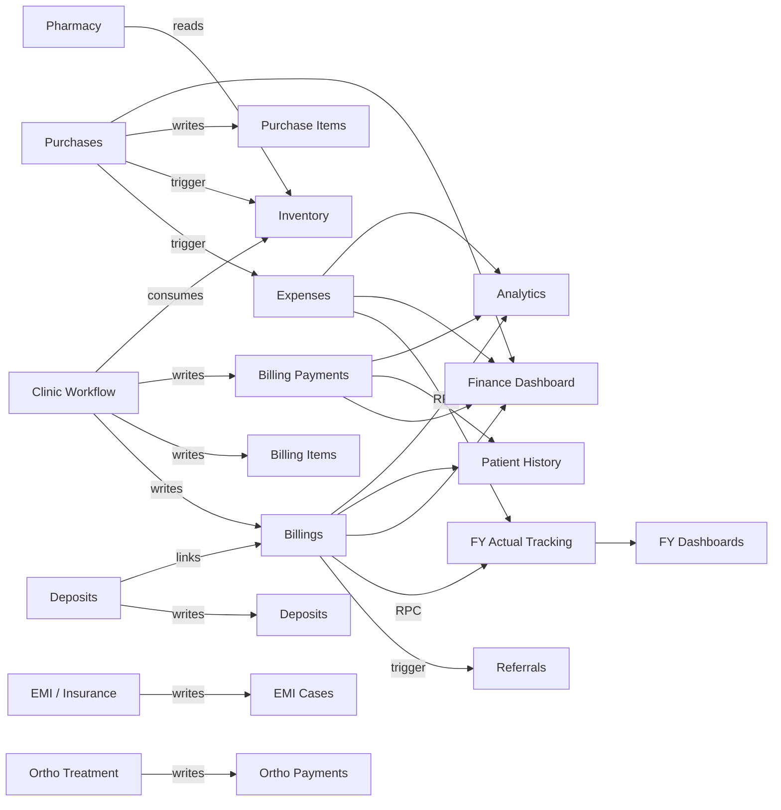
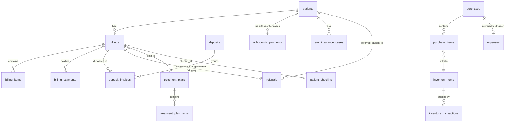
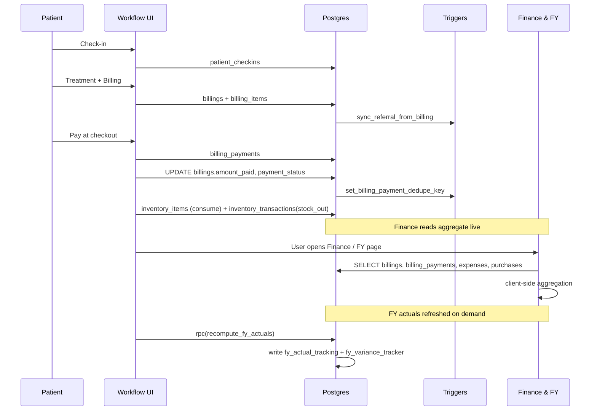

# Finance Architecture Audit

**Version:** v1.0
**Generated:** 2026-06-30
**Scope:** Complete finance data-flow audit across UI, hooks, database, triggers and derived reporting tables.
**Status:** Analysis only — no business logic, schema, or calculation has been changed.

---

## 1. Executive Summary

The finance subsystem is a **client-direct PostgREST architecture**: every UI page queries Postgres tables directly via the Supabase JS client. There is **no service layer** between UI and database. All cross-table consistency is enforced by **triggers** (purchase→expense, purchase→inventory, billing payment dedupe, referral revenue, FY actuals).

**What is solid**
- Payment capture (`billing_payments`) is well-defined and dedupe-protected by a trigger-generated key.
- Purchases automatically mirror into `expenses` and `inventory_items` via `sync_purchase_to_expense` and `handle_purchase_inventory_update`.
- Collected = `SUM(billing_payments.amount)` by `payment_date` is the cash-basis source of truth and is consistently used in `Finance.tsx`.
- FY actuals are derived deterministically from `billings` + `expenses` via `recompute_fy_actuals`.

**Top 5 risks**
1. **No `branch_id` on any money table** (`billings`, `billing_items`, `billing_payments`, `expenses`, `purchases`, `purchase_items`, `inventory_items`, `inventory_transactions`, `deposits`, `orthodontic_payments`, `emi_insurance_cases`, `lab_orders`, `diagnostic_orders`, `referrals`). Branch filters in the UI are effectively no-ops for finance; every branch sees consolidated numbers.
2. **No void/cancelled/refund status on `billing_payments`** — refunds must be modeled as negative `amount` rows; there is no audit trail of cancellations.
3. **`recompute_fy_actuals` is on-demand only** (called from the FY page's "Refresh" button). FY dashboards drift from live `billings`/`expenses` until a manual refresh.
4. **Dual collected-calculation paths**: `Finance.tsx` uses `billing_payments`, but `FinanceReport.tsx` falls back to `billings.amount_paid` when `billingPayments` is empty — two slightly different definitions of "Collected" coexist.
5. **Pharmacy sales are not booked into `billings`** as a distinct revenue stream; pharmacy items only flow through `inventory_items` consumption. Pharmacy revenue is therefore invisible to Finance unless billed manually.

---

## 2. Finance Architecture Overview

```text
┌──────────────────────────────────────────────────────────────────────────┐
│                              UI (React)                                  │
│  ClinicWorkflow → PaymentStep / BillingDetailDialog                      │
│  Finance, Expenses, Purchases, Inventory, Pharmacy, EMI/Insurance,       │
│  DepositsSection, Referrals, FY pages, Dashboard, Analytics              │
└──────────────────────────────┬───────────────────────────────────────────┘
                               │ React Query / useEffect
                               ▼
┌──────────────────────────────────────────────────────────────────────────┐
│                @/integrations/supabase/client (PostgREST)                │
│        Auth = Supabase JWT, RLS enforced per row, GRANTs per role        │
└──────────────────────────────┬───────────────────────────────────────────┘
                               ▼
┌──────────────────────────────────────────────────────────────────────────┐
│                          Postgres (public schema)                        │
│  Source tables: billings, billing_items, billing_payments, expenses,     │
│   purchases, purchase_items, inventory_items, inventory_transactions,    │
│   deposits, deposit_invoices, orthodontic_payments, emi_insurance_cases, │
│   diagnostic_orders, lab_orders, referrals                               │
│                                                                          │
│  Triggers: sync_purchase_to_expense, handle_purchase_inventory_update,   │
│   set_billing_payment_dedupe_key, sync_referral_from_billing,            │
│   update_inventory_status, set_purchase_delivery_date,                   │
│   sync_treatment_to_employee_target, sync_appointment_to_employee_target │
│                                                                          │
│  Derived: fy_actual_tracking, fy_variance_tracker, profit_projection_*   │
│           (refreshed by recompute_fy_actuals RPC, on demand)             │
└──────────────────────────────────────────────────────────────────────────┘
```

**Key architectural notes**
- **No backend API**. UI talks to PostgREST directly. Business rules live in triggers or in component code.
- **Branch scoping** exists for clinical/HR data via `BranchContext` and `user_branches`, but **money tables have no `branch_id` column** — branch filters on Finance are effectively cosmetic.
- **Date anchoring**: `billings.created_at`, `billing_payments.payment_date`, `expenses.expense_date`, `purchases.purchase_date`. These are the four authoritative date axes.
- **RLS**: every public table has policies. Money tables grant `SELECT/INSERT/UPDATE/DELETE` to `authenticated`.

---

## 3. Financial Data Flow

### 3.1 Money-entry points (where money first enters the system)

| Entry point | UI surface | Writes to | Trigger side-effects |
|---|---|---|---|
| Patient pays at checkout | `PaymentStep.tsx` → `billing_payments.insert` | `billing_payments` (+ `billings.amount_paid`, `billings.payment_status` updated in same flow) | `set_billing_payment_dedupe_key`, `sync_referral_from_billing` |
| Invoice raised | `PaymentStep.tsx` → `billings.insert` + `billing_items.insert` | `billings`, `billing_items` | `sync_referral_from_billing` |
| Inventory consumed during treatment | `PaymentStep.tsx` (lines 170–204) | `inventory_items.update`, `inventory_transactions.insert` (`type='stock_out'`) | `update_inventory_status` |
| Purchase invoice from vendor | `Purchases.tsx` → `purchases.insert` + `purchase_items.insert` | `purchases`, `purchase_items` | `sync_purchase_to_expense` (when status=paid), `handle_purchase_inventory_update`, `set_purchase_delivery_date` |
| Manual expense | `Expenses.tsx` → `expenses.insert` | `expenses` | `generate_expense_number` |
| Bank deposit | `DepositsSection.tsx` | `deposits`, `deposit_invoices` (link rows) | — |
| Ortho EMI / installment | `OrthoTreatmentStep.tsx` | `orthodontic_payments` | — |
| EMI / Insurance disbursement | `EMIInsurance.tsx` | `emi_insurance_cases` | `generate_emi_case_code` |
| External diagnostic / lab cost | `DiagnosticsStep.tsx`, `LabOrders.tsx` | `diagnostic_orders.cost`, `lab_orders.rate` | — |
| Referral revenue attribution | (derived) | `referrals.revenue_generated`, `referrals.status` | `sync_referral_from_billing` fires from `billings` insert/update |

### 3.2 End-to-end trace per consumer

**Finance Dashboard** (`src/pages/Finance.tsx`)
- Reads: `billings`, `billing_items`, `billing_payments`, `expenses`, `purchases`, `purchase_items`.
- Computes: Total Billed (sum of `billings.total_amount` in period by `created_at`), Collected (sum of `billing_payments.amount` in period by `payment_date`), Outstanding (`total_amount − amount_paid` for non-cancelled billings), Expenses, Net Profit.

**Revenue** — same source as Finance Dashboard; identical formulas, just rendered as charts.

**Billing** — `Finance.tsx` invoices table; `BillingDetailDialog.tsx` for line items.

**Payments** — `billing_payments` is the only authoritative cash table. Re-displayed on `Finance.tsx` (Payment Collection tab), `PatientPortal.tsx`, `HistoryStep.tsx`.

**Receivables** — derived (`Σ total_amount − Σ amount_paid` per billing for `payment_status IN ('pending','partial')`).

**Expenses** — `expenses` table. Two writers: manual entry (`Expenses.tsx`) and auto-mirror from `purchases` via `sync_purchase_to_expense`.

**Vendor Payments** — derived from `purchases.payment_status='paid'`. No dedicated vendor-ledger table.

**Purchase Management** — `purchases` + `purchase_items`. Trigger `handle_purchase_inventory_update` increments `inventory_items.quantity` and inserts an `inventory_transactions` row of `type='stock_in'`.

**Inventory** — `inventory_items` (current state) + `inventory_transactions` (audit log). Value = `Σ (quantity × cost_price)`.

**Pharmacy** — `Pharmacy.tsx` reads `inventory_items` filtered by category. **Pharmacy sales do not write to `billings`** — gap documented in §11.

**Reports** — `FinanceDownloadReports.tsx`, `DownloadReports.tsx`. Re-read source tables and export CSV/PDF.

**Profit & Loss** — computed in `Finance.tsx` and in `fy_actual_tracking.actual_profit = actual_revenue − actual_expense`.

**Cash Flow** — derived ad-hoc from `billing_payments` (in) + `expenses` (out). No dedicated cashflow table.

**Patient History** — `HistoryStep.tsx`, `PatientPortal.tsx` read `billings` + `billing_payments` for the patient.

---

## 4. Module Dependency Diagram



---

## 5. Database Relationship Diagram



**Read/Write matrix (money tables)**

| Table | Writers | Readers |
|---|---|---|
| `billings` | `PaymentStep`, `BillingDetailDialog` | `Finance`, `FinanceReport`, `Dashboard`, `PatientPortal`, `HistoryStep`, `Analytics`, `Referrals`, `recompute_fy_actuals` |
| `billing_items` | `PaymentStep`, `BillingDetailDialog` | `Finance`, `FinanceReport`, `Analytics` |
| `billing_payments` | `PaymentStep` | `Finance`, `FinanceReport`, `PatientPortal`, `HistoryStep` |
| `expenses` | `Expenses`, trigger `sync_purchase_to_expense`, trigger `generate_expense_number` | `Finance`, `FinanceReport`, `recompute_fy_actuals` |
| `purchases` | `Purchases` | `Finance`, `Purchases`, trigger fan-out |
| `purchase_items` | `Purchases` | `Finance`, `Purchases`, trigger `handle_purchase_inventory_update` |
| `inventory_items` | `Inventory`, `InventoryItemForm`, `PaymentStep` (consume), trigger `handle_purchase_inventory_update` | `Inventory`, `Pharmacy`, `PaymentStep` |
| `inventory_transactions` | `PaymentStep`, trigger | `Inventory` |
| `deposits` / `deposit_invoices` | `DepositsSection` | `DepositsSection`, `Finance` (Deposits tab) |
| `orthodontic_payments` | `OrthoTreatmentStep` | `OrthoTreatment` |
| `emi_insurance_cases` | `EMIInsurance` | `EMIInsurance` |
| `referrals` | `Referrals`, trigger `sync_referral_from_billing` | `Referrals`, `Dashboard` |

---

## 6. API / Service Flow

```text
User action (UI component)
        │
        ▼
React state / form
        │
        ▼
supabase.from("<table>").insert/update/select   ← from src/integrations/supabase/client.ts
        │
        ▼
PostgREST (Supabase) — applies JWT + RLS policies
        │
        ▼
Postgres table mutation
        │
        ├── BEFORE/AFTER triggers (sync_purchase_to_expense, dedupe_key, etc.)
        ├── Cascading updates to derived tables
        └── No write-ahead audit log (gap)
        │
        ▼
UI re-fetches (React Query invalidation OR manual reload via useEffect)
        │
        ▼
Finance Dashboard / Reports / Patient History redraw
```

**Edge functions** in `supabase/functions/` (`create-staff-user`, `manage-admin-users`, `meta-ads`, `platform-insights`, `smile-design-ai`, `social-inbox`, `social-reply`, `verify-platform-connection`, `whatsapp-live-insights`) — **none mutate finance tables**. Finance has no edge-function surface today.

**RPC**: `recompute_fy_actuals(p_branch_id, p_financial_year, p_month)` called from `useFYData.refreshActuals`.

---

## 7. Rendering Matrix

| Value | Source | Rendered on |
|---|---|---|
| Invoice / Bill Total | `billings.total_amount` | Finance (Invoices tab), PatientPortal, HistoryStep, BillingDetailDialog, Dashboard, Analytics, FinanceDownloadReports, FYTreatmentRevenue |
| Amount Paid (per invoice) | `billings.amount_paid` | Finance, PatientPortal, HistoryStep, BillingDetailDialog |
| Payment Status | `billings.payment_status` | Finance, BillingDetailDialog, PatientPortal, HistoryStep |
| Single payment row | `billing_payments.*` | Finance (Payment Collection tab), PatientPortal, HistoryStep |
| Total Billed (period) | `Σ billings.total_amount` filtered by `created_at` | Finance, FinanceReport, Dashboard, Analytics |
| Collected (period) | `Σ billing_payments.amount` filtered by `payment_date` | Finance (primary), FinanceReport (with `billings.amount_paid` fallback) |
| Outstanding | `Σ (total_amount − amount_paid)` for non-cancelled | Finance, FinanceReport, Dashboard |
| Collection % | `Collected / Total Billed` | Finance, FinanceReport |
| Daily Revenue (7d) | `billing_payments` by `payment_date` (fallback `billings` by `created_at`) | FinanceReport |
| Payment-method split | `billings.payment_method` × `amount_paid` | FinanceReport |
| Expense Total | `Σ expenses.amount` by `expense_date` | Finance, Expenses, FinanceDownloadReports |
| Expense by Category | grouped `expenses` | Finance, Expenses |
| Purchase Total | `Σ purchases.total_amount` by `purchase_date` | Finance, Purchases |
| Vendor Outstanding | purchases where `payment_status≠'paid'` | Purchases |
| Inventory Value | `Σ inventory_items.quantity × cost_price` | Inventory, Finance |
| Low-stock count | `inventory_items.status='low_stock'` | Inventory, Dashboard |
| Ortho Paid | `Σ orthodontic_payments.paid_amount` | OrthoTreatment, EMIInsurance |
| EMI Approved | `emi_insurance_cases.approved_amount` | EMIInsurance |
| Insurance Claim | `emi_insurance_cases.approved_claim_amount` | EMIInsurance |
| Deposit Amount | `deposits.deposit_amount` | DepositsSection, Finance (Deposits tab) |
| Referral Revenue | `referrals.revenue_generated` | Referrals, Dashboard |
| FY Actual Revenue | `fy_actual_tracking.actual_revenue` | FY pages |
| FY Actual Profit | `fy_actual_tracking.actual_profit` | FY pages |
| Variance status | `fy_variance_tracker.variance_status` | FYVariance |

---

## 8. Calculation Matrix

| KPI | Formula | Source | Date field | Filters | Business rules |
|---|---|---|---|---|---|
| Total Billed | `Σ billings.total_amount` | `billings` | `created_at` | period, exclude cancelled/void | Counts each invoice once. |
| Collected | `Σ billing_payments.amount` | `billing_payments` | `payment_date` | period; parent `billings.payment_status ∉ {cancelled,void}`; `amount > 0` | Cash-basis. Includes payments for invoices billed in earlier periods. |
| Outstanding | `Σ (billings.total_amount − billings.amount_paid)` | `billings` | `created_at` (of bill) | non-cancelled, balance > 0 | Snapshot from `amount_paid`, not recomputed from payments. |
| Collection % | `Collected ÷ Total Billed × 100` | derived | mixed (see above) | period | Will be ≠100 even if no debt due to cross-period drift. |
| Net Profit | `Collected − Expenses` (Finance.tsx) or `Revenue − Expense` (FY actuals) | `billing_payments`, `expenses` / `billings`, `expenses` | mixed | period | **Two definitions exist** (cash vs accrual). |
| Expenses (period) | `Σ expenses.amount` | `expenses` | `expense_date` | period | Includes auto-mirrored purchase expenses. |
| Inventory Value | `Σ quantity × cost_price` | `inventory_items` | snapshot | `is_active=true` | Uses last `cost_price` write (no FIFO/LIFO). |
| Purchase Total | `Σ purchases.total_amount` | `purchases` | `purchase_date` | period | Includes unpaid. |
| Vendor Paid | `Σ purchases.total_amount` where `payment_status='paid'` | `purchases` | `purchase_date` | period | Mirror also exists in `expenses`. |
| FY Actual Revenue | `Σ billings.total_amount` for the FY-month | `billings` via `recompute_fy_actuals` | `created_at` | FY month, branch_id (NOT effective — see §11) | Manual override flag honored. |
| FY Actual Expense | `Σ expenses.amount` for FY-month | `expenses` | `expense_date` | FY month | Categorized into marketing/salary subtotals. |
| FY Actual Profit | `Revenue − Expense` | derived | FY month | — | Stored, not live. |
| Variance | `Actual − Target` | `fy_variance_tracker` | — | period | Status = green/yellow/red by 90% threshold. |

---

## 9. Event Lifecycle



Parallel lifecycle for vendor purchases:
```text
Purchases.tsx insert → purchases + purchase_items
  → trigger handle_purchase_inventory_update → inventory_items + inventory_transactions(stock_in)
  → trigger sync_purchase_to_expense (when payment_status='paid') → expenses
  → trigger set_purchase_delivery_date (when delivery_status='delivered')
```

---

## 10. Single Source of Truth

| Concept | Authoritative table | Date axis | Notes |
|---|---|---|---|
| Revenue (accrual) | `billings.total_amount` | `created_at` | Used by FY actuals and Total Billed. |
| Cash collected | `billing_payments.amount` | `payment_date` | Used by Finance Collected card. |
| Outstanding | `billings.total_amount − billings.amount_paid` | `created_at` | Snapshot field; not recomputed live from payments. |
| Expenses | `expenses.amount` | `expense_date` | Auto-mirror from purchases is included. |
| Inventory value | `inventory_items.quantity × cost_price` | snapshot | — |
| Inventory ledger | `inventory_transactions` | `created_at` | Append-only. |
| Vendor payments | `purchases` (`payment_status='paid'`) | `purchase_date` | Also surfaces as a row in `expenses`. |
| Pharmacy sales | **No dedicated source** | — | Gap. Either reuse `billings`+`billing_items` with a category flag, or add `pharmacy_sales`. |
| Deposits | `deposits` + `deposit_invoices` | `deposit_date` | Reconciliation aid, not a money mutation. |
| Ortho payments | `orthodontic_payments` | `paid_date` | **Not summed into `billing_payments`** — Finance Collected does not include ortho EMIs unless also booked as `billing_payments`. |
| EMI/Insurance | `emi_insurance_cases.approved_amount`/`approved_claim_amount` | `approved_at` | Cash event lands in `billing_payments` separately. |
| Referral revenue | `referrals.revenue_generated` | derived | Auto-updated by `sync_referral_from_billing`. |
| FY actuals | `fy_actual_tracking` | FY-month | Stale until manual recompute. |

---

## 11. Architecture Issues

1. **No `branch_id` on money tables.** Confirmed by `information_schema`: `billings`, `billing_items`, `billing_payments`, `expenses`, `purchases`, `purchase_items`, `inventory_items`, `inventory_transactions`, `deposits`, `orthodontic_payments`, `emi_insurance_cases`, `lab_orders`, `diagnostic_orders`, `referrals` have no branch column. The `BranchContext` filter on Finance is non-functional for these reads.
2. **Dual "Collected" definitions.** `Finance.tsx` uses `billing_payments` by `payment_date`; `FinanceReport.tsx` falls back to `Σ billings.amount_paid` when `billingPayments` is empty. The two diverge for cross-period payments.
3. **Net Profit ambiguity.** `Finance.tsx` Net Profit uses Collected (cash). FY actual profit uses Revenue (accrual). Same label, different meaning.
4. **No payment status on `billing_payments`.** `billing_payments` has no `status` / `is_void` / `refund_of_id` columns. Refunds and corrections cannot be modeled cleanly.
5. **Purchase-to-expense double-counting risk.** `sync_purchase_to_expense` writes an `expenses` row when `payment_status='paid'`. If a user also manually enters that expense (separate flow), it will be counted twice. There is no uniqueness guard beyond `purchase_id`.
6. **Pharmacy sales gap.** `Pharmacy.tsx` does not insert into `billings` for OTC drug sales; pharmacy revenue is invisible to Finance.
7. **FY actuals staleness.** `recompute_fy_actuals` is only called from a "Refresh" button. No `AFTER INSERT/UPDATE` triggers on `billings`/`expenses` keep it fresh.
8. **Outstanding uses snapshot field.** `billings.amount_paid` is the snapshot, not `Σ billing_payments`. If a payment is hand-edited or deleted, snapshot can drift from the ledger.
9. **Ortho payments are orphan to Finance.** `orthodontic_payments` is not unioned into Collected. Finance under-reports cash if ortho EMIs are not also booked through `billing_payments`.
10. **Missing indexes** likely on `billing_payments(payment_date)`, `expenses(expense_date)`, `purchases(purchase_date)` — to be confirmed; client-side aggregation will scan-table at growth.
11. **No audit log.** No `audit_log` table for money mutations. Refund forensics rely on `created_at` only.
12. **Dead code paths.** `FinanceReport.tsx` collected-fallback branch is dead in practice (Finance always loads payments) but kept for safety; document as deprecated.

---

## 12. QA Testing Matrix

| Action | DB writes | Expected UI updates | Expected reports/dashboards |
|---|---|---|---|
| Create new bill in Workflow | `billings` + `billing_items` insert | PaymentStep shows invoice, PatientPortal & HistoryStep show new bill | Total Billed ↑, Outstanding ↑ |
| Add full payment | `billing_payments` insert + `billings.amount_paid`+`payment_status` update | Bill marked Paid; PatientPortal shows transaction | Collected ↑, Outstanding ↓, Collection % ↑ |
| Add partial payment | same as above; `payment_status='partial'` | Partial chip on bill | Collected ↑ by partial; Outstanding ↓ by partial |
| Edit a billing item amount | `billing_items.update` + `billings.subtotal/total_amount` recomputed | Bill total redrawn | Total Billed and Outstanding adjust |
| Delete a bill | `billing_items.delete` + `billings.delete` | Bill disappears | Total Billed ↓, Outstanding ↓; Collected unchanged unless payments cascade |
| Create purchase, mark paid | `purchases`+`purchase_items` insert → triggers add `inventory_items`+`inventory_transactions(stock_in)`+`expenses` | Purchases list updates; Inventory qty ↑; Expenses list shows mirrored row | Finance Expenses ↑; Inventory value ↑ |
| Create purchase, unpaid | `purchases`+`purchase_items` only; no `expenses` row | Inventory still ↑ via trigger | Expenses unchanged |
| Mark unpaid purchase as paid | trigger inserts mirrored `expenses` row | Expenses list updates | Finance Expenses ↑ |
| Add manual expense | `expenses.insert` | Expenses list updates | Finance Expenses ↑ |
| Record a deposit | `deposits.insert` + `deposit_invoices.insert` per linked bill | DepositsSection list updates | Reconciliation report updates; no change to Collected |
| Record an ortho payment | `orthodontic_payments.insert` | Ortho page updates | **Finance Collected unchanged** (gap) |
| Approve EMI/Insurance | `emi_insurance_cases.update` | EMI page updates | No automatic Finance impact |
| Run FY actuals refresh | `fy_actual_tracking` + `fy_variance_tracker` upsert | FY dashboards redraw | Variance status recolors |
| Switch branch | Branch context updates | Most clinical pages refilter | **Finance shows same numbers** (no branch_id on money tables) |

---

## 13. Recommendations

1. **Add `branch_id` to every money table** with backfill, RLS update, and required filter on every Finance query. Without this, multi-branch finance is unsupported.
2. **Add lifecycle columns to `billing_payments`** — `status` (`active`/`void`/`refund`), `voided_at`, `voided_by`, `refund_of_id` — and treat them in all aggregations.
3. **Promote `billing_payments` to the single Outstanding source.** Compute `amount_paid` from `Σ billing_payments.amount` via a trigger so the snapshot never drifts.
4. **Unify Collected / Net Profit definitions.** Pick cash-basis OR accrual-basis explicitly and label all cards accordingly.
5. **Trigger FY recompute on `billings`/`expenses` mutations** (debounced) instead of manual refresh; or schedule a nightly job.
6. **Close the Pharmacy gap** — route OTC sales through `billings` with a `source='pharmacy'` discriminator.
7. **Union ortho/EMI cash events into `billing_payments`** so Finance Collected is exhaustive; keep ortho schedule table for installment plan management only.
8. **Add a vendor-ledger view** (`v_vendor_ledger`) joining `purchases` + `expenses` to remove double-count risk and give finance a single AP view.
9. **Add indexes**: `billing_payments(payment_date)`, `expenses(expense_date)`, `purchases(purchase_date)`, `billings(created_at)`, plus `(branch_id, <date>)` composites after #1.
10. **Add `finance_audit_log`** (table + trigger on every money table) capturing user, before/after, source page. Critical for HMS/ERP compliance.
11. **Move aggregation server-side** via Postgres views or RPCs (`v_finance_kpis(period_start, period_end, branch_id)`) so UI does not scan thousands of rows.
12. **Document Collected vs Billed drift** in the UI (already done as a tooltip on Finance.tsx).

---

## 14. Appendices

### 14.1 Glossary
- **Accrual basis** — revenue when billed.
- **Cash basis** — revenue when received.
- **Cross-period drift** — payments in period N for bills issued in period N−1.
- **Authoritative source** — the table that the rest of the system should derive from.

### 14.2 Regeneration runbook
1. Re-read these files: `Finance.tsx`, `FinanceReport.tsx`, `PaymentStep.tsx`, `Expenses.tsx`, `Purchases.tsx`, `Inventory.tsx`, `Pharmacy.tsx`, `DepositsSection.tsx`, `EMIInsurance.tsx`, `OrthoTreatment.tsx`, `useFYData.ts`.
2. Re-pull schema for money tables: `SELECT table_name, column_name FROM information_schema.columns WHERE table_schema='public' AND table_name IN (...)`.
3. Re-run sanity SQL: `SELECT date_trunc('month', payment_date) m, SUM(amount) FROM billing_payments GROUP BY 1 ORDER BY 1`.
4. Update Section 11 with any new triggers / tables.
5. Bump the version footer below and regenerate the PDF/DOCX from the same Markdown.

### 14.3 Version footer
| Field | Value |
|---|---|
| Version | v1.0 |
| Generated | 2026-06-30 |
| Author | Lovable Finance Audit |
| Status | Read-only audit, no implementation changes |

---

## 15. Data Lineage Matrix

Field-level trace from DB column to user-facing surface.

| Metric | DB Source | Business Logic | Hook / Loader | Component | Dashboard | Reports | Export |
|---|---|---|---|---|---|---|---|
| Invoice Amount | `billings.total_amount` | `SUM(billing_items.total_price)` at insert | `Finance.tsx` direct `supabase.from('billings').select()` | `BillingDetailDialog`, `FinanceReport` | Finance, FY Finance | FinanceReport, SalesReport | `exportAnalytics.ts` |
| Amount Paid | `billings.amount_paid` | Sum of `billing_payments.amount` per bill, updated in `PaymentStep` | `Finance.tsx`, `PatientPortal` | `PaymentStep`, `BillingDetailDialog` | Finance, Dashboard | FinanceReport | DownloadReports |
| Outstanding | `billings.total_amount - billings.amount_paid` (status ≠ cancelled) | derived in component | `Finance.tsx` | KPI card | Finance, FY Finance | FinanceReport | FinanceDownloadReports |
| Collected (cash) | `billing_payments.amount` by `payment_date` | `SUM` filtered to period | `Finance.tsx` | KPI card "Collected" | Finance | FinanceReport (`billingPayments`-path), GrowthReport | FinanceDownloadReports |
| Revenue (accrual) | `billings.total_amount` by `created_at` | `SUM` per period | `useFYData.ts` for FY; direct query elsewhere | KPI card "Total Revenue" | Finance, FY Finance, SuperDashboard | SalesReport, FinanceReport | exportAnalytics |
| Expense Amount | `expenses.amount` by `expense_date` | `SUM` per category | `Expenses.tsx`, `Finance.tsx` | Expenses table, KPI card | Finance, FY Profit | FinanceReport | DownloadReports |
| Purchase Total | `purchases.total_amount` by `purchase_date` | `SUM` | `Purchases.tsx` | Purchases table | Purchases page | — | — |
| Inventory Value | `inventory_items.quantity * cost_price` | `SUM` over rows | `Inventory.tsx`, `InventoryStatsCards` | KPI card | Inventory page | — | — |
| Vendor Payment | `purchases` (status=paid) → auto `expenses` row | Trigger `sync_purchase_to_expense` | `Purchases.tsx` | Vendor table | Finance (as expense) | FinanceReport | — |
| Cash Collection | `billing_payments.amount` | same as Collected | `Finance.tsx` | KPI | Finance | FinanceReport | FinanceDownloadReports |
| Net Profit | Revenue − Expenses | derived | `Finance.tsx`, `useFYData.ts` | KPI | Finance, FY Profit | GrowthReport | — |
| FY Actual Revenue | `fy_actual_tracking.actual_revenue` | populated by `recompute_fy_actuals` RPC | `useFYTable.ts` | FY tables | FY Finance, FY Variance | — | — |
| Ortho Paid | `orthodontic_payments.amount` | `SUM` per case | direct query in `OrthoTreatment.tsx` | Ortho case detail | — | — | — |
| Deposit Amount | `deposits.amount` | `SUM` open deposits | `DepositsSection` | Finance | — | — | — |

---

## 16. SQL / Data Access Audit

All access is via `@/integrations/supabase/client` → PostgREST. No raw SQL outside DB functions.

| Surface | Tables | Joins (foreign-table syntax) | Filters | Date Field | Branch Filter? | Notes |
|---|---|---|---|---|---|---|
| `Finance.tsx` collected | `billing_payments` | none | `payment_date BETWEEN :from AND :to` | `payment_date` | ❌ (no column) | Branch dropdown is cosmetic |
| `Finance.tsx` revenue | `billings` | `patients(name)`, `billing_items(*)` | `created_at BETWEEN :from AND :to`, `payment_status != 'cancelled'` | `created_at` | ❌ | |
| `Finance.tsx` outstanding | `billings` | none | `payment_status IN ('pending','partial')` | `created_at` | ❌ | |
| `Expenses.tsx` | `expenses` | `expense_categories(name)`, `expense_subcategories(name)` | `expense_date BETWEEN ...` | `expense_date` | ❌ | |
| `Purchases.tsx` | `purchases` | `suppliers(name)`, `purchase_items(*, inventory_items(name))` | `purchase_date BETWEEN ...` | `purchase_date` | ❌ | Triggers mirror to expenses+inventory |
| `Inventory.tsx` value | `inventory_items` | `inventory_categories(name)`, `branches(name)` | none | n/a | ✅ via `branch_id` | Only money-adjacent table with branch_id |
| `PaymentStep.tsx` insert | `billings`, `billing_items`, `billing_payments`, `inventory_items`, `inventory_transactions` | n/a | n/a | n/a | n/a | Multi-step write; not atomic |
| `useFYData.ts` | `fy_master_plan`, `fy_monthly_targets`, `fy_actual_tracking`, `fy_variance_tracker` | none | `financial_year`, `branch_id` | `month` | ✅ | FY tables DO have branch_id |
| `OrthoTreatment.tsx` | `orthodontic_cases`, `orthodontic_payments`, `orthodontic_visits` | `patients(name)` | `case_id` | `payment_date` | ❌ | |
| `DepositsSection.tsx` | `deposits`, `deposit_invoices` | `patients(name)` | `status` | `created_at` | ❌ | |

**Indexes worth confirming:** `billing_payments(payment_date)`, `expenses(expense_date)`, `purchases(purchase_date)`, `billings(created_at, payment_status)`. None of these were verified in this audit — Recommendation §13.

**Performance notes:** Finance.tsx fetches the full month of `billing_payments` + `billings` + `billing_items` + `expenses` on every render. No pagination. Acceptable today; will degrade past ~50k rows/month.

---

## 17. Impact Matrix

Per-action reach across the system.

### 17.1 Patient pays ₹500 at checkout
```
PaymentStep.handlePayment(500)
  └─► INSERT billing_payments (amount=500, payment_date=workflowDate)
       ├─► TRIGGER set_billing_payment_dedupe_key   (dedup key generated)
       └─► UPDATE billings.amount_paid += 500, payment_status (paid|partial)
            └─► TRIGGER sync_referral_from_billing  (if patient came via referral)
Visible in:
  • Finance.tsx       — Collected ↑, Outstanding ↓
  • FinanceReport     — Daily Revenue chart ↑ on payment_date
  • Dashboard         — Today's Collection ↑
  • PatientPortal     — Payment history row appears
  • BillingDetailDialog — bill marked paid/partial
  • GrowthReport      — month KPI ↑
  • FY Actuals        — only after manual recompute_fy_actuals
```

### 17.2 Purchase marked PAID
```
Purchases.tsx update purchases.status='paid'
  ├─► TRIGGER sync_purchase_to_expense   → INSERT expenses (auto)
  └─► TRIGGER handle_purchase_inventory_update → UPDATE inventory_items.quantity, INSERT inventory_transactions
Visible in:
  • Purchases page     — row turns green
  • Expenses page      — auto-expense row visible (⚠ double-count risk if user also added manual)
  • Inventory          — stock level ↑
  • Finance KPI Expense — ↑
  • FY Profit          — only after recompute
```

### 17.3 Manual Expense added
```
INSERT expenses (amount, expense_date, category_id)
  └─► TRIGGER generate_expense_number  → auto EXP-YYYY-NNNN
Visible in:
  • Expenses page, Finance KPI, FinanceReport, FY Profit (after recompute)
```

### 17.4 Refund (current pattern: negative payment row)
```
INSERT billing_payments (amount=-X, payment_date=today)
  └─► UPDATE billings.amount_paid -= X
⚠ No void/refund status. Reconciliation relies on negative-amount detection.
```

### 17.5 Deposit recorded
```
INSERT deposits (amount, status='open')
  └─► later: INSERT deposit_invoices linking to billings (allocation)
Visible only on Finance > Deposits section. Not in Finance KPIs.
```

### 17.6 Pharmacy sale
```
Currently: inventory_items.quantity -= n via Pharmacy.tsx
NO automatic billings/billing_payments row created.
⚠ Pharmacy revenue invisible to Finance unless user manually creates a bill.
```

### 17.7 Ortho payment
```
INSERT orthodontic_payments (case_id, amount, payment_date)
Visible only on OrthoTreatment case detail.
⚠ Not aggregated into Finance.Collected.
```

### 17.8 EMI / Insurance disbursement
```
UPDATE emi_insurance_cases.disbursed_amount, .status
Visible only on EMI/Insurance page. Not aggregated into Finance KPIs.
```

---

## 18. Version Metadata

| Field | Value |
|---|---|
| Document Version | **v2.0** |
| Supersedes | v1.0 (`docs/Finance_Architecture_Audit.md`) |
| Generation Date | 2026-06-30 |
| Project Version (package.json) | 0.0.0 |
| Git Commit | ad3055ff |
| Database | Postgres 15 (Lovable Cloud / Supabase) |
| Environment | Production schema, Preview app |
| Generated By | Lovable Plan-Mode Audit |
| Tooling | code--view, rg, supabase--read_query (SELECT only) |

---

## 19. Regeneration Guide

After each release that touches finance code or schema:

1. **Re-scan code** — `rg "billing_payments|billings|expenses|purchases|inventory_items|orthodontic_payments|deposits" src`.
2. **Re-pull schema** — `SELECT table_name, column_name FROM information_schema.columns WHERE table_schema='public' AND table_name IN ('billings','billing_payments','expenses','purchases','purchase_items','inventory_items','inventory_transactions','deposits','orthodontic_payments','emi_insurance_cases')`.
3. **Sanity checks** —
   ```sql
   SELECT date_trunc('month', payment_date) m, SUM(amount) FROM billing_payments GROUP BY 1 ORDER BY 1;
   SELECT date_trunc('month', expense_date) m, SUM(amount) FROM expenses GROUP BY 1 ORDER BY 1;
   ```
4. **Update Sections 11, 15, 16, 17** with any new tables/triggers/columns.
5. **Bump Version Metadata** (§18): version, date, git SHA.
6. **Re-render artifacts** — run the scripts under `docs/diagrams/` and re-emit `Finance_Architecture.pdf` and `.docx`.
7. **Append to `11_Release_Notes.md`**.
8. **Update `docs/VERSIONS.json`** with the new entry.
